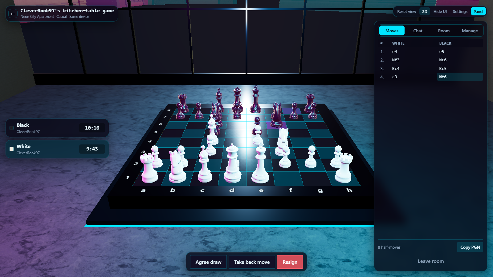
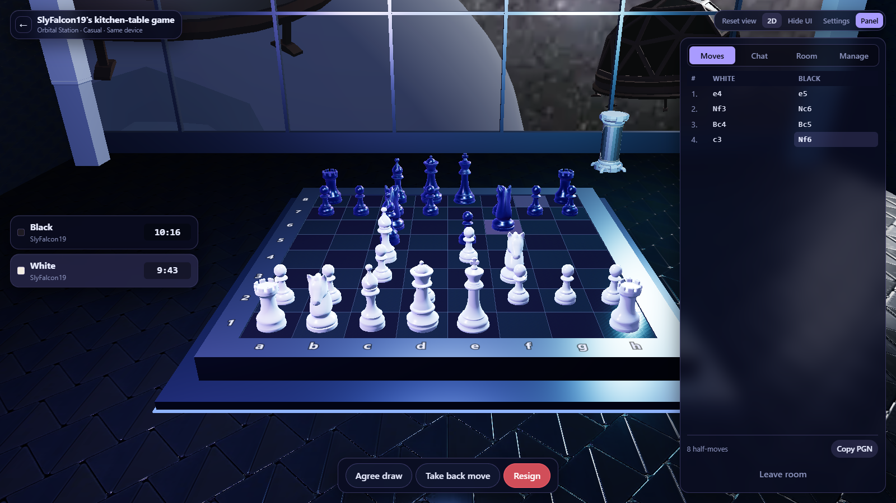

# Gambit3D

A 3D multiplayer chess game. Two detailed maps, real online/LAN/same-device
multiplayer, and a server that is the sole authority on the rules.

The board fills the window; everything else floats above it, so the scene is
never boxed into a small rectangle. Press **H** to hide the interface entirely.





## Built with

TypeScript, React, Three.js, Node.js, Express, Socket.IO and SQLite, tested with
Vitest and Playwright.

## What it does

- **Full standard chess.** Castling, en passant, promotion, check, checkmate,
  stalemate, threefold and fivefold repetition, the fifty- and seventy-five-move
  rules, insufficient material, and flag fall against insufficient material.
- **The server decides everything.** Clients send move intentions; the server
  validates against its own board and broadcasts the accepted result.
- **Four ways to play.** Public rooms in a browsable lobby, private rooms by code
  or link, local Wi-Fi rooms for devices in your house, and same-device play on
  one screen.
- **Two maps.** *Neon City Apartment* — a high-rise room looking out over a
  modelled city in the rain. *Orbital Station* — an observation room in high
  orbit, with a real photographic Milky Way beyond the viewport.
- **A level editor** at `/editor`: move, rotate and scale every model in a map
  inside the real scene, drop in anything from the downloaded packs, and save
  the result. See [LEVEL_EDITOR.md](LEVEL_EDITOR.md).
- **Real moderation.** Host approval, kick, ban, mute, moderator promotion, host
  transfer, room locking — all enforced server-side, not just hidden in the UI.
- **Clocks** from bullet to classical, plus untimed, all with Fischer increment.
- **Reconnection** that restores your seat, the position and the clock.
- **Accessibility**: a fully playable 2D board, keyboard-reachable controls,
  colour-blind-safe markers, reduced motion, scalable interface, high contrast.

## Requirements

- **Node.js 22.5 or newer** (24 LTS recommended). The database uses Node's
  built-in `node:sqlite`, so there is nothing to compile.
- A browser with WebGL for the 3D board. Without it the 2D board is used
  automatically and everything still works.

## Quick start

```bash
npm install
npm run dev
```

Then open <http://localhost:5173>. The main menu runs the real renderer behind
it, so the first thing you see is the game rather than a form. The game server runs on port 8787 and the Vite
dev server proxies to it, so you only need the one URL.

To play against yourself while developing, open a second **incognito** window —
a normal second tab shares the same identity.

## Commands

| Command | What it does |
|---|---|
| `npm install` | Install everything |
| `npm run dev` | Dev servers with hot reload (client 5173, server 8787) |
| `npm test` | Unit + integration tests (212 tests, no browser needed) |
| `npm run test:e2e` | End-to-end tests in a real browser against a production build |
| `npm run build` | Production build of all three packages |
| `npm start` | Serve the production build (client and server on one origin) |
| `npm run start:lan` | Same, but reachable from other devices on your Wi-Fi |
| `npm run lan:info` | Print this computer's LAN address without starting anything |
| `npm run typecheck` | TypeScript across all packages |
| `npm run lint` | ESLint, zero warnings allowed |
| `npm run verify` | typecheck → lint → test → build, in that order |
| `npm run clean` | Delete build output |
| `npm run visual-check` | Screenshot both maps and report what the renderer drew |

Asset commands (only needed if you want to refresh the downloaded assets):

| Command | What it does |
|---|---|
| `npm run assets:fetch` | Re-download the CC0 model packs |
| `npm run assets:models` | Convert and bundle models (needs Blender for the FBX packs) |
| `npm run assets:build` | Optimise textures, HDRIs, sounds and music |
| `npm run assets:repair` | Report model materials that can never draw (see [LEVEL_EDITOR.md](LEVEL_EDITOR.md)) |

## Layout

```
packages/
  shared/    Wire protocol, zod schemas, the permission matrix, Elo
  server/    Express + Socket.IO + chess.js + node:sqlite. Authoritative.
  client/    React + Vite + Three.js via React Three Fiber
scripts/     Asset pipeline, LAN helpers, e2e and visual-check harnesses
tests/       Unit, integration (real sockets) and Playwright end-to-end
```

`packages/shared` is the contract. Both sides import the same types, the same
validation schemas and the same `computeCapabilities` function, so the interface
can never offer something the server will refuse.

## Configuration

Copy `.env.example` to `.env` and edit. Every value has a working default, so an
empty `.env` (or none at all) runs fine for local play.

The settings that matter most:

- `HOST` — `127.0.0.1` for this computer only, `0.0.0.0` to accept connections
  from your network. `npm run start:lan` sets this for you.
- `PORT` — the server port, 8787 by default.
- `CORS_ORIGINS` — comma-separated list of allowed browser origins. Set real
  values in production.
- `SESSION_SECRET` — set this in production so reconnection tokens survive a
  restart. Generate one with:
  ```bash
  node -e "console.log(require('crypto').randomBytes(48).toString('base64url'))"
  ```

Never commit a real `.env`; it is already in `.gitignore`.

## Playing over your own Wi-Fi

```bash
npm run start:lan
```

It builds if needed, prints the exact address to type on the other device, and
tells you what to do about the Windows firewall prompt. Full instructions,
including how to add the firewall rule by hand, are in
[LAN_SETUP.md](LAN_SETUP.md).

## Rearranging a map

Open <http://localhost:5173/editor> (or **Level editor** on the main menu) to
drag the scenery around inside the real scene and save the result. Layouts are
plain JSON in `packages/client/public/layouts/`; delete one to go back to how
the map shipped. [LEVEL_EDITOR.md](LEVEL_EDITOR.md) has the details.

## Deploying online

See [ONLINE_DEPLOYMENT.md](ONLINE_DEPLOYMENT.md). The short version: it is a
single Node process serving both the client and the WebSocket, so any host that
runs Node and supports WebSockets will do.

## How it works

[ARCHITECTURE.md](ARCHITECTURE.md) covers the networking model, where game state
lives, how permissions are enforced, and how assets load and degrade.

## Assets

Every third-party asset, its creator, its licence and what was changed is
recorded in [ASSET_CREDITS.md](ASSET_CREDITS.md). Everything is CC0 apart from
the Milky Way photograph, which is CC BY 4.0 and carries a visible in-app credit.

The game runs with an entirely empty `packages/client/public/assets` folder — it
falls back to procedurally generated pieces, geometry and synthesised sound. The
downloaded assets are an upgrade, not a dependency.

## Troubleshooting

**The 3D board is blank or the map never loads.** The app watches for this and
switches to the 2D board after a few seconds with a message saying so. You can
force 2D from the tool strip or in Settings.

**Another device cannot reach the game.** Run `npm run lan:info`. If it reports
no private network address, the computer is not on a Wi-Fi or wired network. If
it prints an address but the other device still cannot connect, it is almost
always the Windows firewall — see [LAN_SETUP.md](LAN_SETUP.md).

**Both browser tabs are the same player.** Tabs share storage. Use an incognito
window, a different browser, or a different device.

**Sound does not play.** Browsers block audio until you interact with the page.
Click anywhere, or press *Test sound* in Settings.

## Credits and licence

Third-party models, textures, sounds and music are credited in
[ASSET_CREDITS.md](ASSET_CREDITS.md). No licence has been granted for the code, so
all rights are reserved.
